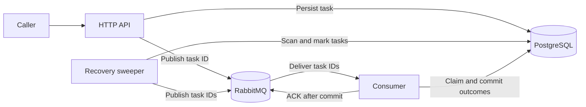
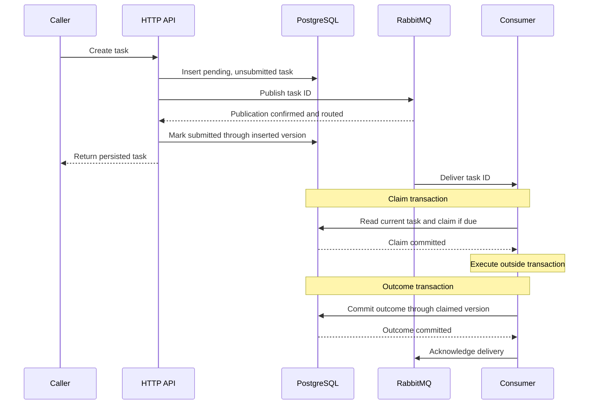

# Architecture

The HTTP API persists tasks in PostgreSQL. RabbitMQ carries task IDs to
consumers, and a sweeper recovers work that needs another delivery or attempt.
The [specification](specification.md) defines the API and task contract;
the [README](../README.md) covers setup and configuration.

## System overview

| Command | Responsibility |
| --- | --- |
| `cmd/server` | Task CRUD, pagination, health and metrics; publishes new task IDs. |
| `cmd/sweeper` | Recovers missed publications, due retries, edits and stale claims. Run one process. |
| `cmd/consumer` | Claims tasks, executes work, commits outcomes and ACKs messages. May scale to several processes. |
| `cmd/cli` | Creates tasks concurrently and polls for completion. |

All three services require PostgreSQL and apply the database migration at
startup. The server connects to RabbitMQ lazily. The sweeper and consumer
require RabbitMQ at startup and declare its exchange, queue and binding.

## Task lifecycle

The normal path is **create → persist → publish → claim → execute → commit
outcome → acknowledge**. The API returns after submission; execution happens
asynchronously.

1. **Persist.** Creation inserts a pending task with no outcome and an initial
   version. A storage failure fails the request.
2. **Publish.** The API sends the task UUID, waits for confirmation and routing,
   then marks the row submitted through the inserted version. Publication or
   marking failure still returns the persisted task; the sweeper recovers it.
3. **Claim.** The consumer locks rows in ID order and claims due pending tasks
   in a transaction. It skips missing, completed and already-running rows.
4. **Execute.** Work runs outside the transaction with at most `CONSUMERS`
   workers. The supplied work waits three seconds; success produces the
   payload's Unicode code-point count as a string.
5. **Commit outcome.** A second transaction records a result, terminal error or
   retry only if the row still has the claimed version and running state. All
   workers finish before this transaction.
6. **Acknowledge.** The consumer acknowledges the batch after its outcomes
   commit. A commit failure leaves the batch unacknowledged.

Messages carry the UUID as both body and message ID. The consumer reads current
task content from PostgreSQL. Publication marking may race with a consumer
claim or an edit; its version check prevents overwriting the newer state.

The consumer uses manual acknowledgements and prefetch equal to `CONSUMERS`.
It collects a batch up to that size or for 100 ms after the first message.
Malformed IDs are NACKed without requeue; valid IDs are parsed once and
deduplicated before processing.

Each task gets `PROCESS_TIMEOUT`. Work is supplied as
`func(context.Context) error` and must honor cancellation, returning `ctx.Err()`
when canceled. Running work between transactions avoids holding row locks
during execution, allowing other consumers, edits and recovery to proceed.

## Failure and recovery

| Situation | Response |
| --- | --- |
| API publication or marking fails | Return the persisted task; sweeper publishes it later. |
| Broker NACKs or returns a publication | Keep the task pending. Postpone an unsubmitted task for one minute and continue the sweep. |
| Sweeper encounters a transport or context error | Stop the pass and return to the session loop. |
| A message arrives before the task is due | Mark it unsubmitted with a version increment, acknowledge it and let the sweeper send it again when due. |
| Execution has a network error or per-task deadline | Schedule a retry while budget remains; otherwise complete with an error. |
| Execution has another error or a panic | Complete that task with an error; a recovered panic does not fail the other tasks. |
| Consumer crashes with running claims | Sweeper releases stale claims into retries or completes them as abandoned when the budget is exhausted. |
| Consumer receives a duplicate ID | Skip missing, completed and already-running tasks. |
| Outcome commits but ACK is lost | Reconnect; redelivered completed tasks are skipped. |
| Business processing or outcome storage fails | Leave the batch unacknowledged and stop the consumer process. |

### What the sweeper selects

Every pass first releases stale claims, then lists up to `SWEEPER_BATCH`
eligible tasks in `(next_retry, created_at, id)` order:

- **Unsubmitted and due.** Tasks with no retries must also be at least five
  seconds old, allowing the API's initial publication to finish. Edits reset
  the retry count and retain the original creation time.
- **Submitted and still pending.** Select these after `TASK_REPUBLISH_AFTER`
  only when that optional lost-message recovery setting is enabled.

The sweeper sends one ID at a time and marks successful publications through
the listed version. A stale-release failure is logged; the pass still attempts
publication. Publication attempts have no terminal retry limit, so permanently
unroutable tasks remain pending and produce warnings. Rejection backoff keeps
them from occupying every sweep.

### Retry and crash recovery

Network failures, execution deadlines and stale releases share
`TASK_RETRY_DELAYS`, defaulting to `1s,10s,60s`: one initial attempt and up to
three retries. A payload edit resets this budget and makes the task eligible
for publication again.

The sweeper selects running claims older than `TASK_STALE_AFTER` using the
database clock and `FOR UPDATE SKIP LOCKED`. The domain releases each claim
into a delayed retry or completes it as abandoned. Changing the version
prevents a late outcome from the previous holder from committing.

`TASK_STALE_AFTER` defaults to five minutes and must be at least
`2*PROCESS_TIMEOUT+10s`, allowing time for work, its outcome commit and clock
skew. Crash recovery waits for this threshold plus the configured retry delay.

### Broker recovery

The exchange and queue are durable. Publications are persistent and use the
`direct` exchange, the queue name as routing key, mandatory routing and
publisher confirms. The queue has no message TTL or dead-letter exchange;
backlogs remain queued without generating publication load from expiry.

Sweeper and consumer sessions declare topology at startup and whenever they
reconnect. A broker with empty storage gets its exchange, queue and binding
recreated before publication or consumption. Purging an existing queue does
not remove topology.

Recovering lost messages requires `TASK_REPUBLISH_AFTER`, which is disabled by
default. Set its threshold above the longest queue wait plus one execution
batch to avoid duplicating messages that are still live.

## Design decisions

### One sweeper; consumers may scale

The sweeper runs as one process because its publication listing does not reserve
the selected tasks. Multiple sweepers could publish the same listed versions
before either marks them submitted. Version checks protect task state but do
not prevent those duplicate publications. Publication is sequential; execution
scales through consumer replicas.

### Claims have no owner identity or heartbeat

Bounded execution and an age threshold keep recovery simple, at the cost of
waiting for that threshold after a crash. Redelivery does not prove that the
claim holder has stopped: a connection can drop while execution continues.
Consumers leave running claims alone, including on startup.

### Version checks protect task changes

Edits, claims and outcomes compare the same version, preventing earlier work
from overwriting newer state. Background processing can make a client's ETag
stale; an edit then returns 409 and requires a fresh read. Publication marking
and rejection backoff preserve the version because they do not change content
or execution ownership.

### Delivery is at-least-once

PostgreSQL writes and RabbitMQ publication or acknowledgements cannot commit
atomically. The task table is also the publication recovery record, keeping
task state and delivery eligibility together without a separate outbox. A
broker outage delays execution while the API continues to persist tasks.

Duplicate messages are expected. Version checks protect the committed outcome
for a claim, but do not guarantee that execution or external side effects
happen once. Work with external side effects must be idempotent.

## Supporting details

### Layers and dependencies

| Package | Responsibility |
| --- | --- |
| `internal/domain` | Task values, validation and lifecycle transitions; independent of infrastructure. |
| `internal/usecase` | Submission, edits, publication recovery, execution and outcome policy. |
| `internal/usecase/port` | Storage interfaces implemented by the repository. |
| `internal/delivery/http` | Routes, JSON DTOs, validation and response mapping. |
| `internal/delivery/amqp` | Delivery batches, UUID parsing, processing calls, ACK and NACK. |
| `internal/repository/task` | PostgreSQL queries and transactions; in-memory test double. |
| `internal/infrastructure/rabbitmq` | RabbitMQ connectivity, topology and task publication. |
| `internal/configs` | Configuration and resource initialization/cleanup. |
| `internal/migrations` | Embedded schema and migration runner. |

Use cases call storage and publication ports; adapters implement those ports.
SQL transactions stay in the repository. AMQP frames and acknowledgements stay
in broker adapters. Tests in `tests/architecture` enforce these boundaries.

### Schema, pagination and migrations

`tasks` stores content, status, claim/publication flags, version, retry
eligibility, timestamps and nullable outcomes. Database checks enforce valid
status, positive versions, nonnegative retry counts, timestamp ordering,
name/payload byte limits and completion/outcome consistency. SQL updates lock
rows and check the expected version; task rules remain in the domain.

Indexes support newest-first pagination, due unsubmitted tasks, submitted
pending tasks and stale running claims. Pagination seeks from the last
`(created_at, id)` pair using its matching index. This avoids an offset that
grows with page depth, and the ID breaks timestamp ties. Creation time stays
fixed across edits; deleting the cursor's row does not invalidate its position.
Pages remain independent reads rather than a snapshot.

The embedded migration runs under a PostgreSQL advisory lock. The
`schema_migrations` ledger records SHA-256 checksums and rejects changed,
missing or unknown migrations. To reset disposable development data, see the
[README](../README.md#development-data).

### Timeouts and shutdown

Startup, HTTP requests, sweeper passes and task execution have bounded
deadlines. Sweeper and consumer processes reconnect after retryable broker
failures. Canceling a broker publication can interrupt concurrent publications;
persisted tasks remain recoverable through the sweeper.

During graceful shutdown, the HTTP server stops accepting requests and drains
active handlers. Consumers preserve completed outcomes and release interrupted
claims through a detached five-second outcome transaction without spending a
retry. Database and broker resources are then closed.

| Budget | Default |
| --- | --- |
| Startup | 60 seconds |
| Reconnect setup | 10 seconds |
| Sweeper pass | 10 seconds |
| HTTP request / readiness probe | 5 seconds / 2 seconds |
| Task execution | 10 seconds (`PROCESS_TIMEOUT`) |
| Detached shutdown outcome commit | 5 seconds |
| HTTP shutdown | 10 seconds |
| Broker dial and connection close | 3 seconds |
