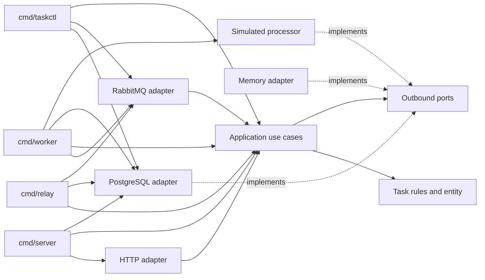

# Architecture

This document describes the implemented task, retry, outbox, and dead-letter paths. The optional CDC relay remains a future design option; the polling relay is the active publisher.

The package layout follows `domain`, `usecase`, `delivery`, `repository`, `configs`, and `infrastructure/processor`. SQL migrations live in `internal/migrations`, and container files live in `deployments`.

## Dependency structure



The HTTP adapter depends on use-case ports and DTOs, and owns HTTP presentation. The RabbitMQ adapter accepts a task-processor interface. PostgreSQL and memory stores implement application storage ports; the simulated processor implements the execution port. `cmd/server`, `cmd/worker`, `cmd/relay`, and `cmd/taskctl` are composition roots.

## Durable task and delivery path

Submission validates the JSON payload and writes the pending task, `TaskSubmitted` event, and work outbox row in one PostgreSQL transaction. The API returns `202 Accepted` only after that transaction commits. The relay reserves due outbox rows, publishes persistent messages with mandatory routing and publisher confirms, and marks rows published after confirmation. A relay crash between confirmation and marking can publish a duplicate; stable event IDs and current execution fencing make delivery at-least-once safe for task state.

The RabbitMQ work envelope carries version, event ID, task ID, and execution ID. The worker validates those IDs and passes the original body into `Consumer.Process`. The application checks that the execution ID is current and the task is due, then claims a lease and records an attempt before calling `Processor.Execute(ctx, taskID, payload)`. The stable task ID is the processor's business idempotency key; execution IDs change across retry and replay generations.

On success, one transaction stores the completed result and finalizes the attempt. On a retryable processor failure, one transaction records the attempt outcome, returns the task to pending, clears the lease, increments `retry_count`, assigns a new execution ID and `not_before`, appends the event, and enqueues the next work message. Defaults are three automatic retries after the initial execution at 1, 10, and 60 seconds. The relay waits until the outbox row is due and publishes directly to the work queue; RabbitMQ TTL is not added, so delay is not applied twice.

A permanent failure or exhausted retry budget is committed as a completed task with an error. The same transaction finalizes the attempt, records the dead-letter metadata, appends the terminal event, and enqueues a DLQ outbox message. The relay publishes that message persistently with a confirmation before marking the outbox row. The failure envelope includes stable message/event IDs, task and execution IDs, reason and code, retry/replay/attempt counts, source event ID, timestamps, and bounded original input diagnostics.

Database errors, transaction failures, active leases, not-due deliveries, and worker shutdown interruptions are not processor failure decisions. They do not spend retry budget. The consumer leaves the original broker delivery unacknowledged and closes the session so RabbitMQ can redeliver it. A lease can be recovered under the same execution ID after expiry; a late prior worker is fenced by its lease token. Stale execution IDs and already terminal tasks are safe no-ops and may be acknowledged after the database confirms that state.

`handle` returns a delivery failure to `consumeSession`; the session owner closes its channel in a defer installed beside channel creation. That cleanup cancels further intake, closes the channel to requeue unacknowledged deliveries, and then waits for workers. Already-started processors use the parent context and may finish; parent shutdown cancels them. Deferred cleanup also runs when topology setup fails.

Malformed envelopes and unknown task IDs cannot use the task outbox. The worker publishes a persistent, versioned quarantine envelope to the DLQ with mandatory routing and publisher confirmation; it acknowledges the source only after that confirmation. If publication fails, the source remains recoverable.

## Attempts and durable diagnostics

`Task.Attempts` counts every successful execution lease start for the task's lifetime, including lease recovery and manual replay. `retry_count` tracks automatic retries in the current replay cycle; `replay_cycle` tracks manually initiated cycles. Attempt rows, failure code/category, bounded error detail, worker ID, execution/event identity, and timestamps are persisted in PostgreSQL. These records—not log parsing—are authoritative for retry counts and investigation. Structured stdout logs supplement them; a centralized log service is optional.

## Manual DLQ operations

`/taskctl` is bundled in the existing worker image and uses the same database and RabbitMQ configuration. Run it inside a worker pod, for example:

```sh
kubectl exec POD -c worker -- /taskctl dlq inspect --limit 20
kubectl exec POD -c worker -- /taskctl dlq replay --message-id MESSAGE_ID --operator OPERATOR --reason "fixed upstream dependency"
```

Inspection and replay use a PostgreSQL advisory lock to serialize operator scans. RabbitMQ does not provide lookup by message ID, so the CLI uses a bounded `basic.get` scan on a dedicated channel. Inspection leaves messages unacknowledged and closing the channel requeues them. A scan can change message order and redelivery flags; an incomplete bounded scan reports that it searched only a prefix. Replay validates a known failure envelope, calls the transactional replay use case, and acknowledges the selected DLQ delivery only after the replay transaction commits. A durable receipt makes a repeated command after a crash safe and rejects conflicting audit details. Malformed and unknown-task records are inspect-only; no automatic or implicit task repair is performed.

## State and API projections

The lifecycle remains the four server-managed states: `pending`, `processing`, `completed`, and `canceled`. Retry scheduling returns a task to `pending`; permanent/exhausted failures complete it with an error. DLQ is a delivery outcome, not a fifth task state.

`domain.Snapshot` is the persistence projection and carries version, lease, execution, retry, and due-time fields. The use-case `TaskResponse` is a separate projection with task ID, payload, status, result/error, timestamps, attempts, retry count, replay cycle, and not-before time. It omits lease tokens, outbox internals, and event history; HTTP does not serialize persistence snapshots.

Cancellation remains final and clears a lease. If cancellation commits before completion, the stale worker cannot overwrite it. A completion committed first makes cancellation a conflict.

The polling outbox relay is the sole current outbox publisher. CDC is an optional future replacement and must preserve the outbox event identity and confirmation/checkpoint contract. A CDC connector cannot itself honor `not_before`; a separate due-time scheduler or matching RabbitMQ delay tier would be required. Polling and CDC must not both publish the same rows.

Docker Compose and the Testcontainers integration suite provide the deployment and broker/database test setup; run commands in the [README](../README.md).
