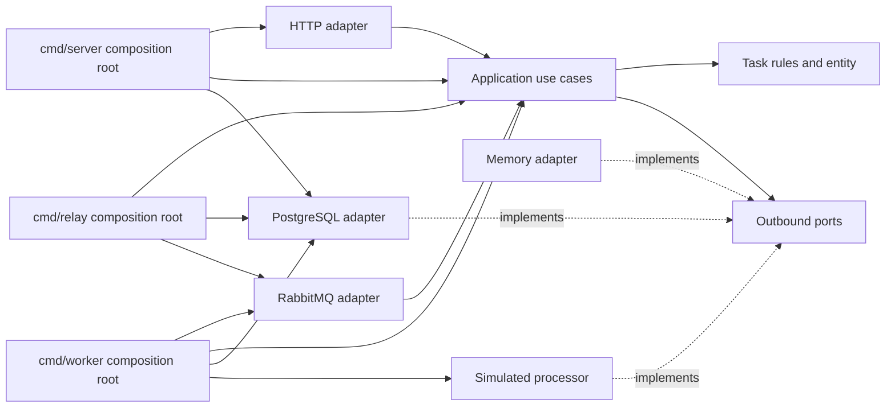
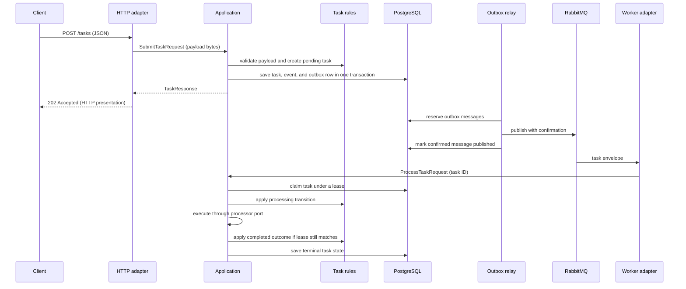

# Clean Architecture

The Go module and project layout remain in place. The architecture change makes the task use cases the boundary between delivery adapters and task rules: the HTTP adapter depends on application interfaces and transport-neutral request/response types, while the task package remains independent of adapters and infrastructure.

## Dependency structure

Arrows show source dependencies. In particular, `httpapi` imports `app` and owns its HTTP JSON presenter; it does not import `task`. The application translates transport-neutral input into task values, invokes lifecycle rules, and maps results into use-case responses. PostgreSQL and in-memory stores implement the application's storage ports. The RabbitMQ adapter accepts the application processor interface. The simulated three-second processor implements the application's processing port.

At runtime, data flows through those dependencies in both directions:

## Inbound application contracts

`app.TaskUseCases` is implemented by `app.Tasks` and provides:

| Operation | Input | Output |
| --- | --- | --- |
| Submit | `SubmitTaskRequest` with payload bytes | `TaskResponse` |
| Get | `TaskRequest` with task ID string | `TaskResponse` |
| Cancel | `TaskRequest` with task ID string | `TaskResponse` |

`app.TaskProcessor` exposes `Process` with a `ProcessTaskRequest` containing the task ID string. The RabbitMQ adapter invokes this interface for a decoded task message. These use-case inputs do not require HTTP request types or domain entity pointers.

`TaskResponse` carries ID, payload, status, optional result or error, creation and update times, and attempt count. The HTTP adapter presents this as JSON. The application validates payload and ID inputs and returns application errors; the HTTP adapter maps those errors to status codes and error JSON.

## Outbound application contracts

The application declares the interfaces it needs; adapters satisfy them:

| Port | Purpose | Adapter or implementation |
| --- | --- | --- |
| `Store` and `Repository` | Read tasks and run transactional insert/save operations | PostgreSQL and in-memory stores |
| `Outbox` | Reserve, mark published, and release outbox messages | PostgreSQL store |
| `Publisher` | Publish an outbox message | RabbitMQ client |
| `Processor` | Execute task payload and return a result or error | Simulated processor |
| `Clock` | Supply application time for transitions | Composition roots provide `time.Now` |

The application package imports the task package to apply the lifecycle rules and uses these outbound contracts to access storage and execution. Infrastructure adapters depend inward on the contracts they implement.

## Persistence projection and use-case response

The entity's `task.Snapshot` is used to restore and persist the task. It carries internal concurrency and recovery fields such as version, lease token, and lease deadline; event history is available separately from the task entity. Storage adapters need these details to perform optimistic updates and recover processing after worker loss.

The use-case `TaskResponse` is a separate projection for callers. It deliberately omits version, lease details, and events. Consequently, database schema needs do not dictate the public HTTP response, and the HTTP adapter does not expose persistence state by serializing an entity or snapshot.

## Request and delivery paths

On submission, HTTP decodes the payload and calls the use case. The application validates the JSON payload, creates a pending task, then inserts the task, its `TaskSubmitted` event, and its outbox record in one transaction. The API responds with `202 Accepted` only after that transaction succeeds.

The relay reserves outbox messages, publishes them with RabbitMQ publisher confirms, and marks confirmed messages. If publishing or marking fails, it releases the reservation for retry. A crash after broker confirmation but before the database mark can produce a duplicate; worker processing checks current task state and lease, making repeated delivery safe.

The RabbitMQ adapter validates the message envelope and calls `TaskProcessor`. The application claims the task with a lease before running the processor. A duplicate message for a completed task does not rerun work. On worker shutdown, interrupted work is redelivered and can be reclaimed after its lease expires. Malformed envelopes and unknown task IDs are dead-lettered; transient storage or broker failures use delayed retry. The sample processor waits three seconds, and business execution failures are stored as completed error outcomes.

Cancellation uses the same application boundary as other HTTP operations. It is idempotent for canceled tasks. If it commits before completion, it clears the lease and the stale worker cannot overwrite cancellation; if completion commits first, cancellation returns a conflict.

## Composition roots and local running

`cmd/server`, `cmd/worker`, and `cmd/relay` are composition roots: they load configuration and connect the HTTP, PostgreSQL, RabbitMQ, application, and processor implementations. Their separation allows the API, workers, and relay to scale independently. Docker Compose and the Testcontainers integration suite remain the deployment and integration-test setup; see the commands in the [README](../README.md).
